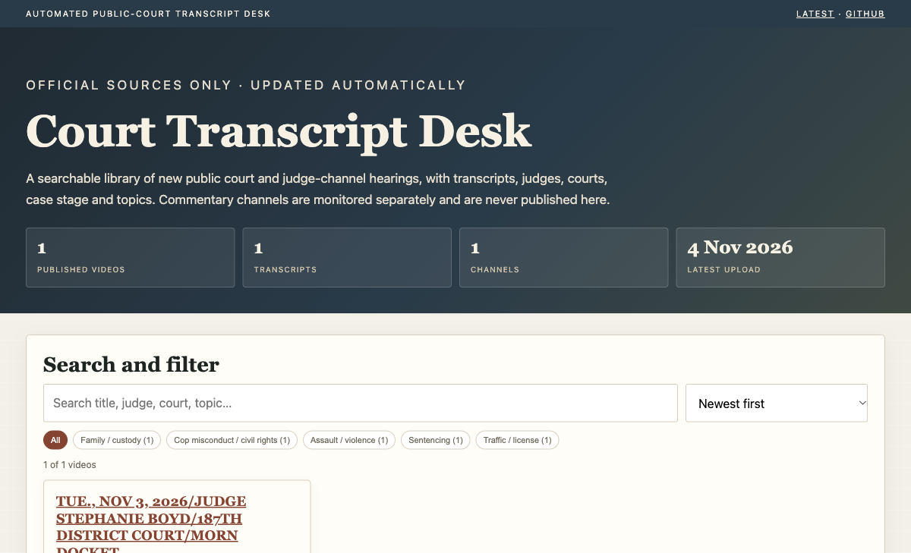

# Court Transcript Desk

**Live student site:** https://naveedpcworld-droid.github.io/court-transcript-desk/  
**Repo:** https://github.com/naveedpcworld-droid/court-transcript-desk



A GitHub-hosted, serverless pipeline that watches public court/judge YouTube channels, detects new uploads, fetches captions, classifies each hearing, and publishes a static student dashboard with daily updates.

**This is an MVP / production starter, not a legal-compliance product.** Read the rights section before publishing anything.

## What it does

```
channels.yml
   ↓
GitHub Actions (every 6h / manual)
   ↓
RSS → new video IDs
   ↓
yt-dlp metadata + captions
   ↓
rule-based judge/court/topic/case extraction
   ↓
data/index.json + data/transcripts/*.json
   ↓
static site in /site → GitHub Pages
```

- No server to maintain.
- No database.
- No video/audio stored.
- Static site is fast, searchable, and works on GitHub Pages.
- Private/competitor channels can be monitored while being excluded from the public site.

## Important: GitHub-hosted runners and YouTube

The first live run confirmed that GitHub’s datacenter IP is blocked by YouTube for `yt-dlp` (“Sign in to confirm you’re not a bot”). RSS/metadata still worked.

The pipeline now uses YouTube’s public **InnerTube transcript panel endpoint** first. That endpoint works from GitHub-hosted runners and returns timestamped caption segments without cookies. If it stops working, these fallbacks are available:

1. **Supadata key** — add repo secret `SUPADATA_API_KEY` (paid, reliable).
2. **Self-hosted runner** — install a runner on a residential-IP Mac and set repo variable `RUNNER_LABEL=self-hosted`.
3. **Private proxy/cookies** — possible, but fragile and has terms-of-service risk.

The initial failed run left some records marked `no_captions`; the workflow now runs `pipeline.refresh --limit 50` to retry them.

## Quick start (local)

```bash
cd court-transcript-system
python3 -m venv .venv
. .venv/bin/activate
pip install -r requirements.txt

# ingest a few new videos
python -m pipeline.ingest --max-new 5

# build the site data
python -m pipeline.build_site

# preview
python3 -m http.server 8765 -d site
# open http://127.0.0.1:8765
```

Tests:

```bash
pytest -q
```

## Deploy to GitHub

1. Create a **private** repo (recommended while rights are unresolved).
2. Push this folder.
3. Repo → Settings → Actions → General → Workflow permissions → **Read and write permissions**.
4. Repo → Settings → Pages → Source: **GitHub Actions**.
5. Run the workflow once: Actions → “Update court transcript desk” → Run workflow.
6. When the run finishes, open the Pages URL from the deployment.

GitHub Pages on a **private** repo may require a paid GitHub plan. If Pages is unavailable, keep the repo private and deploy `site/` to Cloudflare Pages/Netlify with access control.

Cron is best-effort. GitHub may delay scheduled runs; for near-real-time use WebSub or a small server/worker.

## Add a channel

Edit `channels.yml`:

```yaml
- name: Judge Stephanie Boyd
  handle: "@judgestephanieboyd4233"
  source_tier: official_judge
  rights_status: public_court_feed
  public: true
  publish_transcript: true
  judge: "Judge Stephanie Boyd"
  court: "187th District Court, Bexar County, Texas"
```

The first run resolves `@handle` to a `UC…` channel ID and caches it in `data/channels.json`.

Important for judge channels: past live streams are under `/streams`, not `/videos`; RSS catches both.

## Rights model

| Field | Meaning |
|---|---|
| `public: true` | May appear on the public student site |
| `publish_transcript: true` | Transcript may be stored and shown |
| `rights_status` | `public_court_feed`, `licensed`, `live_only`, `no_recording_order`, `commentary_internal_only`, `unknown` |

**Default safety:** media and commentary channels are monitored but `public: false` and `publish_transcript: false`. The no-recording court is fully blocked.

Do not make the repo public or publish transcripts until you have checked:

- YouTube Terms and the court’s recording/reuse policy.
- Copyright/licence for Court TV, Law & Crime, CVN and commentary channels.
- Sealed cases, minors, victims, expunged records.
- Whether a feed says **“DO NOT RECORD.”**

A transcript is a derivative work. A public court feed is not automatically a free redistribution licence.

## What is automated

- New upload detection via YouTube RSS.
- Metadata: title, date, duration, views, thumbnail, description.
- Captions: yt-dlp first, `youtube-transcript-api` fallback.
- Timestamped transcript.
- Topic/judge/court/stage/outcome extraction.
- Static JSON + site build.
- Git commit + GitHub Pages deployment.

## What is not automated (yet)

- ASR for videos without captions. The record gets `transcript_status: no_captions`; add a Whisper worker if needed.
- LLM classification. The MVP is deterministic (`rules-v1`) and free.
- Production-grade retries/proxies. yt-dlp can be blocked on datacenter IPs.
- Email/WhatsApp/Telegram digest delivery. The static site + GitHub commit history is the first version.
- Authentication/cohorts. Use Cloudflare Access or a private deployment for students.
- Legal review.

## Data model

```
data/
  index.json          # all monitored records, including private/restricted
  channels.json       # resolved channel IDs
  state.json          # processed video IDs
  transcripts/
    <video-id>.json   # segments + text (only if publish_transcript)
site/
  index.html
  video.html
  digest.html
  data/
    index.json        # public records only
    transcripts/      # public transcripts only
    stats.json
    channels.json
    digest.json
    feed.xml
```

`site/data/index.json` is generated; do not hand-edit it.

## Scaling

This design is good for roughly **10–50 channels** with captions and a few new videos per day.

For 100+ channels, 24/7 live capture, or no-caption ASR:

- Replace GitHub Actions with a small worker + queue.
- Add `faster-whisper` on a GPU.
- Add object storage for temporary audio.
- Add Postgres + pgvector and Meilisearch.
- Add a review queue for names/case numbers.

The static site can stay.

## GitHub Actions cost

- Public repo: standard GitHub-hosted Actions minutes are free.
- Private repo: free minutes apply, then per-minute billing.
- Captions are fast. ASR is the expensive part.
- RSS and GitHub Actions are free; Supadata/ASR are paid beyond free tiers.
- Captions via yt-dlp are free but only from a non-blocked IP.

## Current deployment status

- Public repo + GitHub Pages: **live**.
- Scheduled workflow: **active** (every 6 hours + manual).
- GitHub-hosted caption fetch: **working through InnerTube**; `yt-dlp` remains blocked.
- Supadata/self-hosted are fallbacks, not required for normal operation.

## Security

- Do not commit API keys. Use GitHub Secrets.
- Do not commit cookies.
- Keep the repo private until rights are cleared.
- Review every transcript before student publication if names/charges matter.

## Roadmap

1. Run the workflow for 14 days; measure miss rate and caption coverage.
2. Add a no-caption ASR worker only for cleared sources.
3. Add LLM extraction with JSON schema + confidence, behind a feature flag.
4. Add daily email/WhatsApp digest.
5. Add Cloudflare Access for student login.
6. Add semantic search (pgvector) when the library exceeds a few thousand records.

## Files

- `channels.yml` — source registry and rights flags
- `pipeline/` — ingest, captions, classification, site build
- `site/` — static UI
- `.github/workflows/update.yml` — schedule, commit, Pages deploy
- `tests/` — parser/classifier tests
- `AUTOMATED_TRANSCRIPT_SYSTEM.md` (in the parent workspace) — the broader product/architecture plan

## Disclaimer

Not legal advice. Court records may be public but reuse, recording and redistribution can still be restricted. Verify every source and every transcript before publishing.
